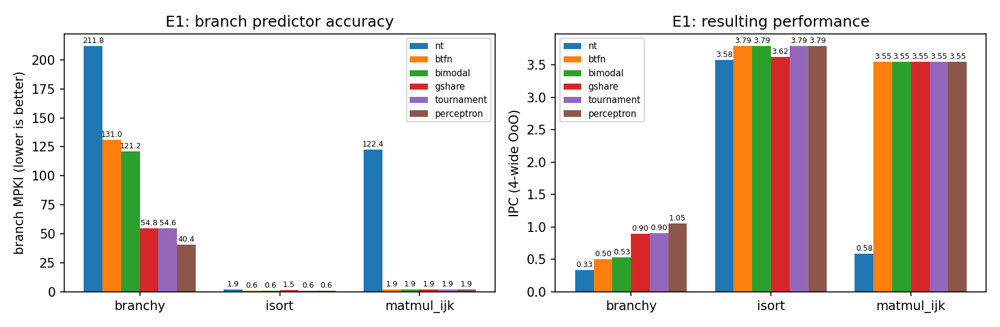
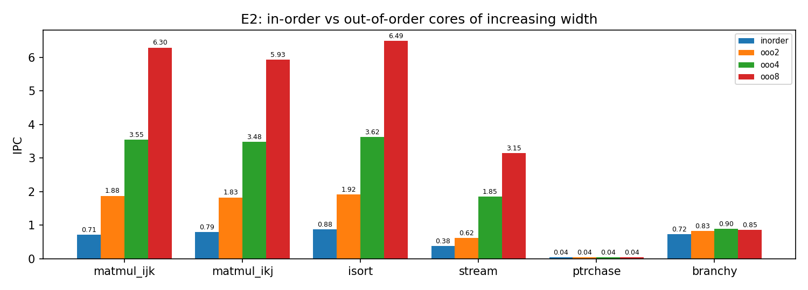
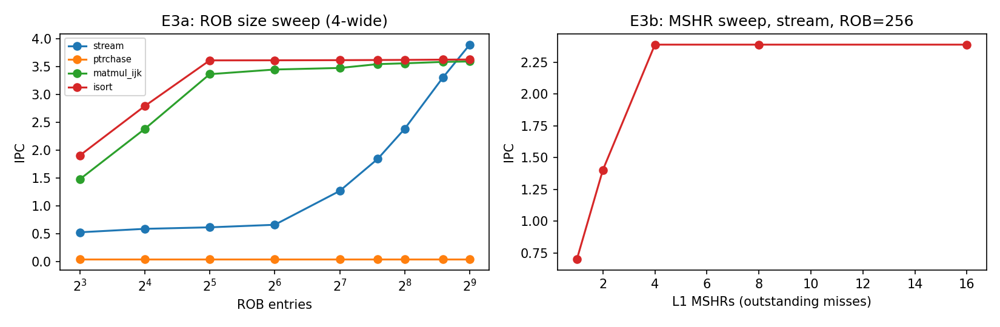
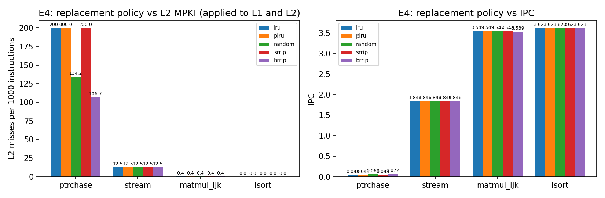
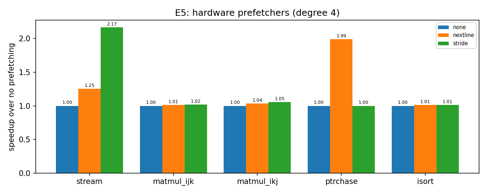
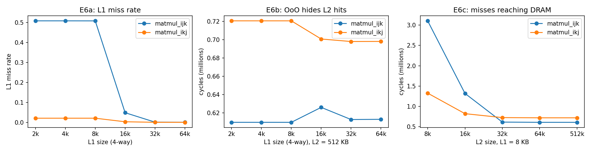

# archlab-riscv

A **cycle-level RISC-V microarchitecture explorer** written in C++17. It runs real RV32I+M programs on a functional simulator, replays the committed instruction stream through a parameterizable **in-order / out-of-order superscalar timing model**, and lets you study how branch predictors, caches, replacement policies, prefetchers, ROB size and miss-handling resources shape performance.

The repository contains the simulator, an RV32 assembler, six benchmark kernels with Python reference results, unit tests, and a reproducible **design-space exploration** (140 simulations, 6 experiments) with the findings below.

## Headline results

All numbers come from `make experiments` (raw data in `results/results.csv`). Core: 4-wide OoO, 192-entry ROB, 32 KB 8-way L1, 512 KB 8-way L2, 100-cycle memory, unless stated.

| Question | Finding |
|----------|---------|
| Which branch predictor is best on a hard, data-dependent branch mix? | **Perceptron** (24-bit global history): 40.4 mispredictions per 1000 instructions (MPKI), versus 54.8 for gshare, 121.2 for bimodal and 211.8 for static not-taken. It reaches 87.5% accuracy, which is the ceiling for this kernel because one of its four branches per iteration is a fair coin flip. IPC rises from 0.33 (static) to 1.05. |
| How much does out-of-order execution buy? | 4-wide OoO vs 1-wide in-order IPC: **5.0x** on matrix multiply (0.71 to 3.55), 4.1x on insertion sort, 4.8x on streaming. On **pointer chasing there is no gain at all** (IPC 0.042 vs 0.043 on every core, ROB sizes 8 to 512): dependent misses cannot overlap. |
| What limits memory-level parallelism? | On the streaming kernel IPC grows from 0.53 (ROB 8) to 3.90 (ROB 512). Separately, with ROB = 256, IPC scales 0.70 / 1.40 / 2.39 for 1 / 2 / 4 L1 MSHRs and then saturates, so the ROB and the MSHR count are both bottlenecks. |
| Which replacement policy handles a cyclic working set larger than the cache? | On a 768 KB random pointer cycle in a 512 KB L2, LRU, tree-PLRU and SRRIP all miss every access (200.0 L2 MPKI). Random gives 134.2 and **BRRIP** (bimodal insertion) gives 106.7, which is +67% IPC over LRU (0.043 to 0.072). |
| Do prefetchers help? | A per-PC **stride prefetcher gives 2.17x** on the streaming kernel (IPC 1.85 to 4.00); next-line gives 1.25x. Both are useless on pointer chasing (see the caveat in the limitations). |
| Does loop interchange (ijk to ikj) pay off? | It depends on where the misses go. With an 8 KB L1 it cuts the L1 miss rate from 50.9% to 2.2%, but a 512 KB L2 and the out-of-order window hide the L2 latency completely, and ikj executes 12% more instructions, so ikj needs 14% *more* cycles than ijk at a 32 KB L1. When misses reach DRAM (8 KB L1 and 8 KB L2), **ikj is 2.3x faster** (1.33 M vs 3.10 M cycles). |








## Architecture

```
 program.bin --> [functional RV32IM interpreter] --> committed trace (pc, addr, regs, taken)
                                                           |
              +--------------------------------------------+
              v
   [timing model]  fetch/dispatch (W per cycle, ROB limit, redirect after mispredict)
        |            issue (operands ready, W slots, memory ports, in-order option)
        |            execute (ALU 1, MUL 3, loads = cache latency)  commit (in order, W per cycle)
        +--> branch predictor (nt, btfn, bimodal, gshare, tournament, perceptron)
        +--> L1D -> L2 -> memory: LRU / tree-PLRU / random / SRRIP / BRRIP, MSHRs,
             next-line and per-PC stride prefetchers with in-flight (late) fill tracking
```

| File | Role |
|------|------|
| `src/cpu.hpp` | RV32I + MUL interpreter that records the committed-instruction trace |
| `src/bpred.hpp` | six direction predictors |
| `src/cache.hpp` | set-associative caches, replacement policies, MSHRs, prefetchers |
| `src/core.hpp` | in-order / out-of-order timing model |
| `src/main.cpp` | CLI, prints one JSON line per run |
| `scripts/asm.py`, `scripts/benchmarks.py` | assembler and the six benchmarks with Python reference results |
| `scripts/run_experiments.py` | reproduces every figure and `results/results.csv` |
| `tests/test_units.cpp` | analytically checkable tests of caches, predictors and the core |

## Benchmarks

| Name | Stresses | Size |
|------|----------|------|
| `matmul_ijk`, `matmul_ikj` | 64x64 matrix multiply, strided vs unit-stride access | 2.2 M / 2.4 M instructions |
| `isort` | insertion sort of 768 random integers: data-dependent branches | 1.2 M |
| `stream` | sum of a 1 MB array: bandwidth and prefetching | 1.3 M |
| `ptrchase` | 12288-node random linked list (768 KB): memory latency, thrashing | 0.3 M |
| `branchy` | one random branch, one period-8 branch, one branch correlated with the first | 0.7 M |

Each program stores a checksum that `scripts/run_tests.py` compares with a Python reference.

## Quick start

Requires `g++` (C++17), Python 3 and `matplotlib` (for the figures only).

```bash
make test          # unit tests + functional validation of all benchmarks
make experiments   # re-runs all 140 simulations and regenerates docs/*.png

# a single run
python3 scripts/benchmarks.py build/bench
./build/archsim --prog build/bench/stream.bin --preset ooo4 --pf stride --bp perceptron
```

Useful options: `--preset inorder|ooo2|ooo4|ooo8`, `--width`, `--rob`, `--mem-ports`, `--penalty`, `--bp nt|btfn|bimodal|gshare|tournament|perceptron`, `--bp-bits`, `--l1 size:ways:line`, `--l2 size:ways:line`, `--repl lru|plru|random|srrip|brrip` (or `--l1-repl` / `--l2-repl`), `--l1-lat`, `--l2-lat`, `--mem-lat`, `--mshr`, `--pf none|nextline|stride`, `--pf-degree`.

## Validation

- Functional: all six benchmarks produce exactly the checksum of an independent Python implementation.
- Unit tests check behaviour that can be derived by hand: LRU / PLRU eviction order, SRRIP scan resistance, BRRIP thrash resistance, cold-miss latency, stride-prefetch coverage, gshare learning a period-4 pattern, correlation exploited by gshare and the perceptron but not by bimodal, IPC equal to the width for independent instructions and to 1 for a serial chain, ROB-limited overlap of independent misses, serialization of dependent misses, and per-mispredict penalty.

## Modelling assumptions and limitations

This is a trace-driven timing model, so treat absolute IPC values as comparisons between configurations rather than predictions for real silicon.

- No wrong-path execution, so no wrong-path cache pollution. The BTB, return-address stack and instruction cache are perfect; only branch *direction* is predicted.
- Memory: caches are updated in program order, loads and stores are assumed to disambiguate perfectly with no store-forwarding stalls, stores never stall the pipeline, and write-back traffic, DRAM banks and bandwidth are not modelled. Prefetch fills do not occupy MSHRs.
- Functional units have fixed latencies (ALU 1, MUL 3) and there is no structural hazard apart from issue width and memory ports.
- The `ptrchase` gain from next-line prefetching (IPC 0.043 to 0.086) is not real prefetching benefit: only 0.9% of those prefetches are used. The extra fills perturb the thrashing L2, the same effect that makes random replacement beat LRU there.
- Not yet validated against gem5 or RTL.

## Ideas for extension

Return-address stack and BTB models, wrong-path simulation, a DRAM bank/row-buffer model, a store queue with forwarding, DRRIP set dueling, a TAGE predictor, and cross-validation against gem5.
